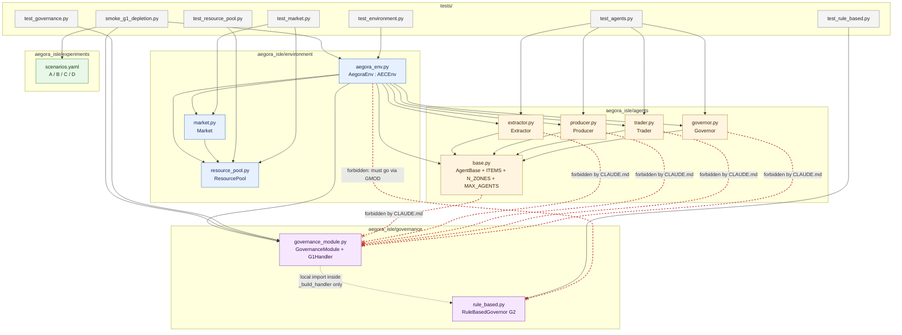
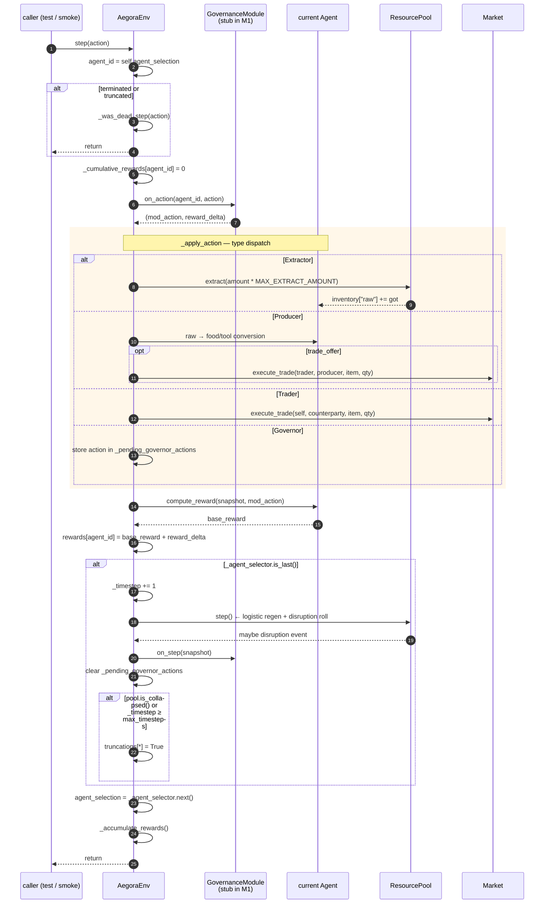
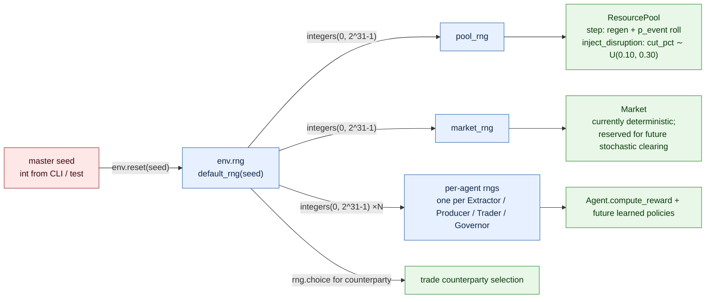

# Project Map — Aegora Isle (M2 Sprint 2.1–2.2 state)

Three mermaid diagrams + a file-by-file reading guide. Use this when you
want to debug the env without having to load the whole codebase into your
head at once.

---

## 1. Module dependency graph

Who imports whom. Read top-to-bottom: arrows point from importer to imported.
The hard rule from `CLAUDE.md` is the **dashed red barrier**: nothing inside
`aegora_isle/agents/` may import from `aegora_isle/governance/`. The env is
the only place those two meet.

---

## 2. One AEC step — what happens when `env.step(action)` is called

This is the most failure-prone area in M1 (Sprint 1.4 risk note). The cycle
must be: every agent acts once → then the world ticks. Reward is assigned
to the **current** agent **before** the selector advances.

---

## 3. Seeding flow — one seed in, every stochastic decision determined

`CLAUDE.md`'s "Random seeding contract" is the hard rule. The diagram shows
the single seed branching into per-component generators. Every box that
generates randomness owns its **own** `Generator` instance, but all of them
descend from the master seed.

---

## File-by-file reading guide

Read in this order if you're new to the repo. Each entry tells you **what
it owns**, **what to look at first when debugging**, and **what's
intentionally absent** (so you don't go looking for it).

### Docs at repo root

| File | What it owns | First-read tip |
|------|-------------|----------------|
| `CLAUDE.md` | Non-negotiables every agent + human must respect (no governance leakage, AEC-only, exact CSV columns, seeded RNG). | If a test seems pedantic, the rule is here. |
| `MASTER_PLAN.md` | Full milestone roadmap, sprint structure, weekly cadence. | Skim Part E for M1 context. |
| `M1_PLAN.md` | Sprint-by-sprint M1 plan with paste-ready prompts and verification commands. | Authoritative for M1 acceptance. |
| `PROJECT_PLAN.md` | Higher-altitude build plan (scope, risks, architecture). | Read once, then forget; M1_PLAN supersedes for details. |
| `WEEK_0_SPRINT.md` | RL pre-study sprint (not code). | Skip if you already know PPO/SAC. |
| `DECISIONS.md` | Locked design choices: 1 raw + 2 produced goods; agent-count rounding; Dict action spaces; N_ZONES=4; MAX_AGENTS=500; collapse-threshold deferral; seeding contract. | Read before changing any agent or env constant. |
| `README.md` | User-facing setup + AC verification commands + schema/repro/hardware sections. | The 8 sections are mandated by spec §9 + §12.3 — don't drop any. |
| `pyproject.toml` | uv-compatible deps, Python 3.10–3.12, hatchling build, ruff config. | Edit here, not in a requirements.txt. |

### `aegora_isle/environment/`

| File | What it owns | Debug tip / what's absent |
|------|-------------|---------------------------|
| `resource_pool.py` | `ResourcePool`: stock, logistic regeneration, disruption-event roll, `is_collapsed` (M1 placeholder = `stock < critical_min`), `state_dict`. | Stock not depleting? Check that `extract()` is being called and that `regeneration_rate` isn't overwhelming `MAX_EXTRACT_AMOUNT`. The professor's subsistence-based collapse definition is **deferred to M2**. |
| `market.py` | `Market`: scarcity-adjusted pricing (`base * (1 + α * (1 - stock/initial))`), `execute_trade` (peer-to-peer, conservation-preserving, returns `None` on invalid trades), trade log. | No exceptions raised on invalid trades — returns `None` so agents can probe freely. If a trade silently fails, check seller inventory and buyer cash. |
| `aegora_env.py` | `AegoraEnv(AECEnv)`: agent population (G1 = 17/17/16, G2/G3 = 12/13/13/12 at n=50), per-agent `_apply_*` methods, AEC step cycle, snapshot dict, termination on collapse/horizon. | `api_test` failures usually mean (a) wrong `_cumulative_rewards` reset timing, (b) `agent_selection` not advanced, or (c) obs not in declared space. Inspect `_snapshot_state()` first — every agent's obs feeds from it. |

### `aegora_isle/agents/`

All five files are **governance-agnostic**. A static AST check in
`tests/test_agents.py::test_agents_module_does_not_import_governance`
enforces it. Action spaces follow the spec §2.1 Dict encoding literally —
irrelevant parameter fields per `action_type` are simply ignored by
`_apply_*` in the env.

| File | What it owns | Debug tip / what's absent |
|------|-------------|---------------------------|
| `base.py` | `AgentBase`: inventory dict `{raw, food, tool}`, cash, alive, age, abstract spaces; module constants `MAX_AGENTS=500`, `N_ZONES=4`, `ITEMS=("food","tool")`. | When you see a wealth number that looks off, `wealth(prices)` is here. |
| `extractor.py` | `Extractor`: 6-dim Box obs, Dict action `{extract, idle, move_to_zone}`. Reward = raw units extracted this step. | `move_to_zone` is a no-op at env level for M1 (no spatial model yet). |
| `producer.py` | `Producer`: 7-dim obs, Dict `{produce, store, trade_offer}`. Reward = value of goods manufactured this step at current prices. | `trade_offer` sells to a randomly-chosen Trader counterparty. |
| `trader.py` | `Trader`: 10-dim obs (5 head + last-5 trade volumes), Dict `{buy, sell, idle}`. Reward = net trade profit (cash delta + inventory-value delta). | The "last-5 trade volumes" feed from `env._last_5_trade_volumes`, updated on every successful trade. |
| `governor.py` | `Governor`: 15-dim obs (5 KPI head + 10-bin wealth histogram), Dict `{set_cap, set_redistribution, sanction, idle}`. **Reward returns `0.0` in M1** — the spec §2.2.2 composite lands in M2 with the KPI logger. | `target_agent_idx` domain is `MAX_AGENTS=500` for forward-compat per spec §11.2; out-of-range = no-op (handled by `GovernanceModule` in M2). |

### `aegora_isle/governance/`

| File | What it owns | Debug tip / what's absent |
|------|-------------|---------------------------|
| `governance_module.py` | `GovernanceModule(config_path, rng)`: loads YAML, dispatches to a regime handler. `G1Handler` (identity + zero delta, no-op `on_step`) lives here inline; `RuleBasedGovernor` (G2) and `AdaptiveRLGovernor` (G3) are imported **locally inside `_build_handler`**, never at module top level. | The single entry point per CLAUDE.md: nothing outside this file may import `rule_based` or `adaptive_rl`. `AegoraEnv`'s zero-config default is `G1Handler()` directly (no YAML needed — G1 has no parameters). |
| `rule_based.py` | `RuleBasedGovernor` (G2): caps Extractor amount at `extraction_cap`, probabilistically sanctions violators, redistributes Producer/Trader cash to Extractors every `redistribution_period` env timesteps (reads `env_state["timestep"]` directly — no internal counter to drift). | `MAX_EXTRACT_AMOUNT` is **duplicated** here (not imported from `aegora_env.py`) to keep governance/ independent of environment/ — see the module dependency graph above. A drift-detector test asserts the two constants stay equal. |
| `adaptive_rl.py` | **Not yet implemented.** G3's SAC-trained Governor lands in M2 Sprint 2.5 — see `G3_PLAN.md`. `GovernanceModule` raises `NotImplementedError` for `regime: G3` until then. | Don't go looking for this file before Sprint 2.5. |
| `configs/g1_ungoverned.yaml` | `regime: G1`, no parameters. | Exists so `governance_condition` reads `"G1"` consistently across all three regimes' CSVs. |
| `configs/g2_rule_based.yaml` | `extraction_cap`, `sanction_probability`, `sanction_magnitude`, `redistribution_period`, `redistribution_rate`. Starting defaults — tuned in M3 Sprint 3.3 against AC08. | If AC08 fails in M3, this is the file to retune (with a `DECISIONS.md` entry explaining why). |
| `configs/g3_adaptive_rl.yaml` | Schema locked ahead of implementation: composite reward weights, SAC hyperparameters. Loadable today; not yet constructible into a working `GovernanceModule`. | — |

### `aegora_isle/experiments/`

| File | What it owns | Debug tip |
|------|-------------|-----------|
| `scenarios.yaml` | A/B/C/D parameters: `initial_stock`, `regeneration_rate`, `event_rate`, `critical_min`, `scarcity_alpha`, `base_prices`. | Tuning for AC08 (G1 > G2 > G3 Gini in Scenario A) happens in M3, **not** here. If you change a value during M1, document why in `DECISIONS.md`. |

### `aegora_isle/kpi/`

Empty placeholder. The 5-KPI logger (Gini, HDI, GDP, depletion rate, MTSC),
the CSV writer (spec §3.1 schema), the JSON state file with SHA-256, and
the convergence monitor all land in **M2**.

### `tests/`

| File | What it covers |
|------|----------------|
| `test_resource_pool.py` | Determinism, regen, depletion, event probability (~5% over 10k steps → 400–600 events at ±4σ), clipping, seeding contract. |
| `test_market.py` | Price formula (worked example), monotonicity, conservation, invalid-trade handling, log accumulation, timestep stamping. |
| `test_agents.py` | Per-class obs-in-space, action-sample consumability, seeding contract; **two redundant governance-isolation checks** (grep + AST walk). |
| `test_environment.py` | `pettingzoo.test.api_test` (AC01), population split (AC02), per-agent classes, obs validity at reset, seeded determinism of `agent_selection`, collapse-truncation. |
| `smoke_g1_depletion.py` | AC03 — runs G1-D for up to 1000 timesteps with 20 random-action agents, saves `data/smoke/g1_d_depletion.png`, asserts final < 95% initial. |

### `data/`

| Path | What lives there |
|------|------------------|
| `data/smoke/g1_d_depletion.png` | AC03 visual — should slope downward with disruption-event step-downs. |
| `data/runs/` (gitignored) | M3 will deposit 360 CSV files here. |
| `data/states/` (gitignored) | M2 will deposit per-run JSON state files with SHA-256 checksums. |

---

## When something breaks — first place to look

| Symptom | First file to open |
|---------|-------------------|
| `pettingzoo.test.api_test` fails | `aegora_env.py::step` — check `_cumulative_rewards[agent_id] = 0` precedes reward assignment; check `agent_selection` advances after `_accumulate_rewards`. |
| Resource stock not depleting in smoke test | `aegora_env.py::_apply_extractor` and `MAX_EXTRACT_AMOUNT`. Then `resource_pool.py::step` for regen rate. |
| Test marked "governance isolation" fails | An `aegora_isle/agents/*.py` file gained a `from aegora_isle.governance ...` import. Move that logic into `governance_module.py`. |
| "ResourcePool requires a numpy.random.Generator" | Caller passed an `int` seed instead of a `Generator`. Convert with `np.random.default_rng(seed)`. |
| Agent obs not in its declared space | `_snapshot_state()` is missing a key the agent's `get_observation` reads. Check dummy values in `tests/test_agents.py::_dummy_env_state` for the canonical shape. |
| Two runs with the same seed diverge | Some module is creating its own `np.random.default_rng()` instead of accepting one. Grep: `np\.random\.(default_rng|rand|uniform|choice)` inside `aegora_isle/`. |
